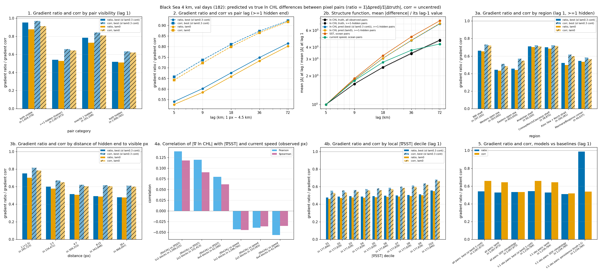

# Black Sea: results so far (2026-10-17, updated 2026-10-20)

A starting point for deciding what to try next. Numbers come from [FINDINGS.md](FINDINGS.md) and
[models/RUNS.md](../models/RUNS.md). The error breakdown is from `python -m analyses.blk4.error_breakdown`.

**Set-up.** Copernicus 1 km L3 chlorophyll and the regional physics reanalysis cover 2014–2024, 3,997 days. Two grids:

- **2 km:** 395 × 550 pixels, 93,594 of them ocean.
- **4 km:** a 2 × 2 block average of the 2 km grid, 197 × 275 pixels, 23,606 of them ocean.

**Split.** Val years are 2017 and 2021, test years 2019 and 2023, and the rest train (2,542 days). Scoring uses every
fourth val and test day: 182 val days and 183 test days.

**Score.** MAE in ln CHL on observed pixels hidden under a real cloud mask taken from another day (the "donor" day).
**2 km and 4 km scores are not comparable**: the target and the hidden pixels differ.

## 1. Best models

| grid | model | val MAE | test MAE | DOY climatology, val / test | n hidden px, val / test |
|---|---|---|---|---|---|
| 4 km | 3D stem, λ 0.3, 150 epochs (50 + two warm restarts) | **0.1498** | **0.1430** | 0.3583 / 0.3112 | 1.06 M / 1.10 M |
| 4 km | 3D stem, λ 0.3, width 96, 50 epochs | 0.1527 | 0.1480 | same | same |
| 4 km | 3D stem, λ 0, 50 epochs | 0.1561 | 0.1509 | same | same |
| 2 km | 3D stem, λ 0.3, 20 epochs | 0.1606 | 0.1525 | 0.3604 / – | 4.20 M / 4.38 M |

"3D stem" means `--model temporal3d`. It sees CHL with donor clouds on days t−4..t+4, plus 8 physics features
(SST, salinity, mixed-layer depth, sea-level anomaly, currents, wind), the day-of-year climatology, coordinates and the
year. It has 8 dilated residual blocks (661 k parameters) and is trained with L1 loss plus a gradient loss (weight 100).
λ is the weight of the semi-Lagrangian transport residual.

**Other metrics for the best 4 km model on val.** Values are for val days; test is in metrics.json.

| metric | value |
|---|---|
| RMSE | 0.243 |
| bias | −0.006 |
| r | 0.966 |
| gradient ratio (std of the predicted gradient / std of the true gradient) | 0.54 |
| gradient correlation | 0.66 |
| MAE on visible (not hidden) pixels | 0.092 |

## 2. Model families at 2 km (same val days)

| model | val MAE | epochs | note |
|---|---|---|---|
| DOY climatology | 0.3604 | – | |
| UDE: daily transport + learned source, forecast | 0.2007 | 4 | 1-day lead; persistence 0.2142 on that set (different pixel set) |
| dilated CNN, ±2 days | 0.1975 | 12 | batch 8 |
| spatial nODE (steady anisotropic diffusion) | 0.1772 | 6 | |
| 3D stem, λ 0 | 0.1627 | 20 | resumed after an interruption with a fresh optimizer state |
| 3D stem, λ 0.3 | 0.1606 | 20 | |

## 3. What changed the score (each a single seed)

| change | grid | Δ val MAE | comparison |
|---|---|---|---|
| physics loss λ 0 → 0.3 | 2 km, 20 ep | −0.0021 | the λ 0 run was resumed after an interruption |
| physics loss λ 0 → 0.3 | 4 km, 20 ep, batch 8 | −0.0001 | |
| physics loss λ 0 → 0.3 | 4 km, 50 ep, batch 16 | −0.0015 | |
| physics loss λ 0.3 → 1.0 | 4 km, epoch 12 of a 50-ep schedule | +0.026 | periodic val 0.1968 → 0.2230 |
| physics loss, residual on cloud pixels | 4 km, 20 ep | \|r\| 0.127 → 0.098 | MAE unchanged |
| 8 → 7 / 6 / 5 / 4 residual blocks | 2 km, epoch 12 | +0.0045 / +0.0011 / +0.0061 / +0.0102 | |
| window ±4 → ±3 days | 2 km, epoch 12 | −0.0014 | |
| 20 → 50 epochs, batch 8 → 16 | 4 km, λ 0.3 | −0.0091 | two things changed at once |
| +50 epochs, warm restart at lr 1e-3 | 4 km | −0.0047 | val jumped to 0.178 at the restart, then recovered |
| +50 epochs, warm restart at lr 1e-4 | 4 km | −0.0001 | periodic val 0.150–0.153 throughout |
| `--geo-static` (bathymetry, 8 river distances, physics-ok mask) | 4 km, 50 ep, λ 0 / λ 0.3 | −0.0005 / −0.0010 | test −0.0031 / +0.0014; region signs disagree between the two λ |
| width 64 → 96 (1.41 M parameters) | 4 km, 50 ep, λ 0.3 | −0.0019 | test −0.0010; gradient ratio 0.522 → 0.530 |
| post-hoc high-pass gain (blur + 1.2 × detail) | 4 km, best run | – | test 0.14300 → 0.14284 |

Seed-to-seed noise has not been measured on the Black Sea. On the Indian Ocean it is about 0.0001.

## 4. Where the best 4 km model errs (val)

**By region:**

| region | MAE | bias | DOY clim MAE | n px | n days |
|---|---|---|---|---|---|
| W open sea | 0.114 | +0.002 | 0.331 | 283,566 | 166 |
| E open sea | 0.115 | +0.002 | 0.334 | 458,430 | 177 |
| Crimea/Kerch/Caucasus shelf | 0.177 | −0.070 | 0.354 | 21,784 | 161 |
| NW shelf | 0.205 | −0.030 | 0.415 | 154,519 | 168 |
| Anatolian shelf | 0.206 | −0.053 | 0.388 | 32,553 | 173 |
| Azov + Kerch | 0.274 | +0.017 | 0.403 | 86,163 | 140 |
| Marmara/Bosporus | 0.324 | −0.065 | 0.568 | 25,307 | 144 |

**By true ln CHL decile.** MAE is 0.10–0.12 from D1 to D7. It rises to 0.148 in D8, 0.254 in D9 and 0.334 in D10.
Bias runs from +0.084 in D1 to −0.128 in D10: low values come out too high and high values too low.

**By the day's observed fraction.** MAE falls from 0.213 on the cloudiest fifth of days to 0.133 in the fourth
fifth, then reads 0.143 on the clearest fifth.

**By month.** MAE ranges from 0.129 in July to 0.178 in February. The climatology's error ranges from 0.240 in
December to 0.531 in July.

**Data notes.**
- In Azov and Marmara the salinity input is NaN almost everywhere, set to 0. The currents there are also missing,
  since the reanalysis domain is smaller than the CHL box.
- `chl_l3` reaches 234,663 mg/m³ on ocean pixels. 5,257 of 3.89 M sampled values exceed 100 mg/m³. The 3D-stem runs
  do not clip them.

## 4b. Gradient diagnosis (best 4 km model, val)

| pairs (lag 1, 4.5 km) | gradient ratio | gradient corr | n pairs |
|---|---|---|---|
| both ends visible | 0.952 | 0.969 | 1,604,378 |
| exactly one end hidden | 0.784 | 0.842 | 161,108 |
| both ends hidden | 0.518 | 0.634 | 1,906,765 |

- **By lag (hidden pairs):** the ratio is 0.54 at 5 km, 0.60 at 9 km, 0.68 at 18 km, 0.75 at 36 km and 0.82 at 72 km.
- **By distance into the gap:** 0.75 next to a visible pixel, levelling off at 0.48–0.49 beyond 8 px (36 km).
- **By region:** open sea 0.44–0.46, shelves 0.66–0.71.
- **Link to SST:** |∇ ln CHL| correlates with |∇SST| at r ≤ 0.14 on observed pixels. The ratio rises from 0.48 to 0.56 between the lowest and highest SST-gradient deciles.
- **Baselines on the same pairs:** persistence 0.99 ratio / 0.54 corr; DOY climatology 0.53 / 0.53.
- **Calibration (2026-10-18):** OLS slope of Δtruth on Δpred is 1.08 [1.06, 1.10] at 1 px, and 1.07–1.10 at 2–16 px.
  Inputs screened against |∇ ln CHL|: SST, vorticity and strain gradients correlate at r ≤ 0.16 (≤ 0.06 more than
  8 px from land).
- **Motion-only fills (2026-10-20, [flow_gate](flow_gate/results/flow_gate.md)):** the nearest visible day in t−4..t+4,
  moved with 0.25 × currents into the gap, scores 0.045–0.15 worse than the best model on the same pixels. Its
  gradient ratio is 1.1 but its correlation only 0.30–0.34, against 0.54 / 0.64 for the model.

## 5. Related baselines (2 km, forecasting rather than gap filling)

| baseline, 1-day lead | val MAE | n px |
|---|---|---|
| persistence (copy yesterday's observed pixels) | 0.188 | 9.20 M |
| persistence moved along the currents | 0.198 | 9.20 M |
| persistence moved along currents scaled by 0.25 | 0.186 | 9.20 M |
| DOY climatology | 0.375 | 9.20 M |

The median current displacement is 5.4 cells per day at 2 km. The physics loss uses these same currents.

## 6. Open questions and untried options (for brainstorming; updated 2026-10-20)

**Answered since 10-17**
- **4 km vs 2 km on 2 km truth** (bilinear upsampling, fair pixel set): 4 km is better by 0.0086 [0.0067, 0.0103]
  (0.1510 vs 0.1596, 8.3 M px), and better in every region and every gap-distance bin beyond 1 px. The training budgets
  differ (150 vs 20 epochs) and were not controlled.
- **Bathymetry and river distances as inputs** (`--geo-static`): neutral (section 3).
- **Wider backbone (width 96):** −0.0019 val at 50 epochs; not yet tried with the warm restarts.
- **Better motion:** the tracer project ([tracer/TRACER.md](tracer/TRACER.md), shelved). Fading by scale matters more
  than moving. An oracle patch shift gains ≤ 0.008 over 0.25 × currents at 1 day. Motion-only gap fills are far
  worse than the model (section 4b).

**Evaluation**
- How large is seed noise on the Black Sea? Every Δ in section 3 is a single seed.
- How does the Copernicus gap-free L4 product score on the same hidden pixels? The Black Sea has no external
  benchmark yet.
- A fair 2 km comparison: the 20-epoch 4 km run against the 20-epoch 2 km run on 2 km truth.
- Retrieval noise floor: OC-CCI per-pixel RMSD or SENSORMASK could bound how low hidden-pixel MAE can go.
- Black Sea runs use `donor_exclude` 0, so the donor day can sit inside the ±4-day window. The Indian Ocean nowcast
  used 8.
- `chl_cnn/viz.draw_day` takes context days by store index; the trainer uses calendar days. They differ on 18 val
  days, so the notebook's t±1 panels can be off on those days.

**Error structure (section 4)**
- Error is concentrated in the top two CHL deciles, on the shelves, in Azov and in Marmara. The bias there is negative
  (predictions too low).
- The gradient ratio is 0.54, so predicted fields are smoother than the truth. It falls with distance into the gap.
  Open: is this MAE-driven shrinkage under uncertainty, or misaligned averaging of context days? If it is shrinkage,
  it would need a loss change or a sampled (ensemble / generative) output, not better inputs.
- Visible-pixel MAE is 0.092, against 0.150 on hidden pixels.

**Physics**
- The transport residual falls with λ, but MAE barely moves.
- λ = 1.0 slowed early training.
- Advecting with the full-strength currents does worse than plain persistence. Tracked CHL features move at
  0.42–0.46 × the reanalysis currents, with weak direction agreement (R² 0.24–0.38).
- Untried: λ between 0.3 and 1.0, and a currents scale factor (about 0.25) in the loss.
- Untried, from the tracer work:
  - **Warped context channels.** Move the ±4 context days into day t's frame (0.25 × currents), possibly split into
    the < 20 / 20–50 / 50–150 km bands with their fade times (1 / 2.5 / 10 d) as confidence, and add them as input
    channels.
  - **Deformable alignment** in the 3D stem, with offsets initialised from the currents.

**Inputs**
- No outlier clipping of CHL (`--chl-max`) in the 3D-stem runs; the spatial nODE runs used 100 mg/m³.
- Azov and Marmara have no salinity or currents.
- New in the 4 km store, not yet gap-filler inputs: rsntds (light) and friver (river discharge).

**Training**
- Restarting at lr 1e-4 gave nothing.
- Untried on the 4 km grid:
  - width 96 with the warm restarts;
  - more blocks;
  - the ±3-day window (which helped slightly at 2 km);
  - a different loss weighting for high-CHL pixels;
  - the forecast and nowcast set-ups (only run on the Indian Ocean).
