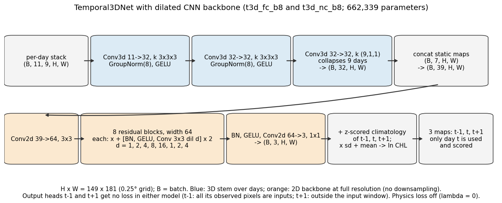
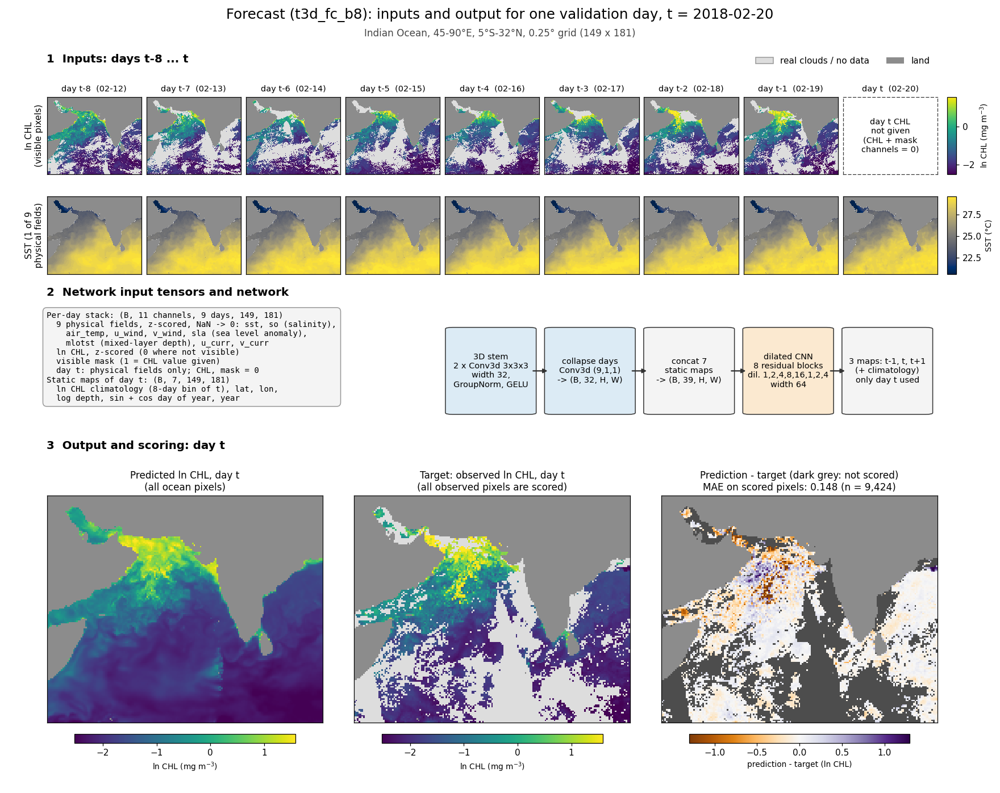
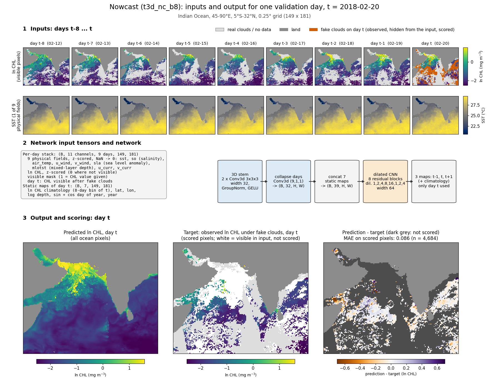

# Forecast and nowcast models (t3d_fc_b8, t3d_nc_b8)

Two models predict the daily satellite chlorophyll map (ln CHL, natural log of mg m^-3) of the Indian Ocean for a day t,
on a 0.25° grid of 149 x 181 pixels (45-90°E, 5°S-32°N). Clouds hide much of every daily map. Both models use the same
network and the same physical inputs. They differ in what chlorophyll they see on day t, and so in which pixels they are
scored on.

| | Forecast `t3d_fc_b8` | Nowcast `t3d_nc_b8` |
|---|---|---|
| Days in the input | t-8 ... t (CHL of t-8 ... t-1; physical fields of all 9 days) | t-8 ... t |
| Day-t CHL given? | No (CHL and mask channels of day t are zero) | Yes, the pixels left visible after fake clouds |
| Scored pixels | all observed day-t pixels | day-t pixels hidden by fake clouds (truth known) |

Network, shared by both (662,339 parameters, `chl_cnn/models.py` `Temporal3DNet`, dilated backbone):

The network adds its output to the day-of-year climatology, then undoes the z-scoring to give ln CHL. It outputs maps for
t-1, t and t+1, but only day t is used and scored. In both models the extra maps get no loss: every observed t-1 pixel is
already an input, and t+1 is outside the input window, so the trainer drops that term. The physics loss is off (lambda = 0).

**Example day.** Both figures below show validation day **2018-02-20**. On that day:

- real clouds cover 43.6 % of ocean pixels
- fake clouds hide 49.7 % of the observed pixels (28.1 % of ocean pixels; 4,684 pixels)
- t-8 ... t-1 are all in the record, with 51-70 % of ocean pixels observed on each day

The northern Arabian Sea has high chlorophyll on this day.

## Forecast (`t3d_fc_b8`)

The input is days t-8 ... t-1 with their real chlorophyll observations, plus day t's physical fields. Day t's chlorophyll
value and mask channels are zero. The model predicts the full day-t field. It is scored on every pixel observed on day t,
since none of them was an input. Row 1 shows the CHL input and row 2 shows SST, one of the nine physical fields. Physical
fields come from ocean and atmosphere models with no cloud gaps, so they are given for every day, including t.

## Nowcast (`t3d_nc_b8`)

The input is the same 9-day window. Here, day t also carries the chlorophyll it still has after "fake clouds" are
applied. Fake clouds copy the cloud pattern of another day, the donor: day-t pixels that are observed on t but cloudy on
the donor are hidden from the input. Their true values are known, so they are the scored pixels (vermillion in the day-t
input panel). Donor exclusion (`--donor-exclude 8`) forbids any donor within 8 calendar days of t, so each donor is at
least 9 days away. Days t-8 ... t-1 keep their real observations (`--context-clouds none`).

Fake clouds are drawn in two ways:

- **Training:** donors are redrawn every epoch from training days whose day-of-year is within ±15 days of t (any year).
- **Validation and test:** donors are fixed by seed (0 for validation, 1 for test) and drawn from the same split's days.

## Input tensors (both models)

- **Per-day stack** `(B, 11, 9, 149, 181)`: 11 channels for each of 9 days.
  - 9 physical fields, z-scored with training statistics; missing values become 0: `sst`, `so` (salinity), `air_temp`,
    `u_wind`, `v_wind`, `sla` (sea level anomaly), `mlotst` (mixed-layer depth), `u_curr`, `v_curr`.
  - ln CHL, z-scored, 0 where not visible.
  - Visible mask.
- **Static maps of day t** `(B, 7, 149, 181)`:
  - ln CHL climatology of t's 8-day day-of-year bin (z-scored)
  - lat, lon and log10 depth (each z-scored)
  - sin and cos of day of year
  - year, as (year - 2009) / 7
- **Concatenation:** after the 3D stem collapses the day axis to `(B, 32, H, W)`, the static maps are added to make
  `(B, 39, H, W)`.

## Training

- **Loss:** L1 on z-scored ln CHL of day t.
  - Nowcast: weight 1 on hidden pixels and weight 0.1 (`--vis-weight`) on visible day-t pixels.
  - Forecast: weight 1 on all observed day-t pixels.
- **Gradient-difference loss, weight 100:** L1 between predicted and observed differences of neighbouring pixels along
  lat and lon. It counts pixel pairs where both pixels are observed and at least one is scored.
- **Optimiser:** 20 epochs, AdamW (lr 1e-3, weight decay 1e-4), cosine learning-rate schedule, batch 8, mixed precision.
  The saved weights are from the best validation epoch, which is epoch 20 for both runs.
- **Split, interleaved by year:** validation years are 2001, 2007, 2013 and 2018 (1,458 days). Test years are 2004, 2010,
  2016 and 2020 (1,463 days). Training uses the remaining days of 1997-09 to 2020 (5,540 days with any observation).

## Results (ln CHL MAE)

MAE is the mean of |prediction - observation| in ln CHL. The models in rows 1 and 2 are scored on the fixed
donor-exclude-8 hidden pixels of every validation day (n = 5,009,957). Source:
`results/nowcast_comparison.json`.

| Scoring | Nowcast | Forecast | Gap-filler t-4..t+4 | Persistence | Climatology |
|---|---|---|---|---|---|
| Fake-cloud pixels, as scored | **0.1090** | 0.1251 | 0.1303 | 0.1671 | 0.2541 |
| Reweighted to the real-cloud age mix | **0.113** | 0.133 | n/a | 0.201 | 0.251 |

Notes on the table:

- **Forecast column:** `t3d_fc_b8` weights, run evaluation-only on these pixels as `t3d_fc_b8_dx8`.
- **Gap-filler column:** `t3d_dil_c4_60ep_gdl100` weights, run evaluation-only as `t3d_dil_c4_60ep_gdl100_dx8`. Its
  context days carry the donor's clouds.
- **Persistence:** the last observed value at the pixel within t-1 ... t-8, or the climatology if there is none.
- **Climatology:** per-pixel mean ln CHL of the 8-day day-of-year bin over the training days.

The reweighting uses the "age" of a pixel: the number of days since its last observation within t-1 ... t-8, or none.
Fake-cloud pixels have a different age mix from pixels under real clouds:

| Validation pixels | 1 d | 2-3 d | 4-8 d | none |
|---|---|---|---|---|
| Fake-cloud (scored) pixels | 49.1 % | 27.4 % | 15.9 % | 7.6 % |
| Real-cloud pixels | 21.3 % | 23.4 % | 24.4 % | 30.8 % |

The reweighted row takes the per-age MAEs in `nowcast_comparison.json` and weights them by the real-cloud mix. The
gap-filler has no reweighted value because its inputs do not follow these age bins. The reweighting assumes that, within
an age bin, the error is the same under real and fake clouds. This cannot be tested, because there is no truth under real
clouds.

Forecast scored on all observed day-t pixels (`results/t3d_fc_b8.json`):

| Split | Forecast | Persistence | Climatology | n pixels |
|---|---|---|---|---|
| Validation | 0.1285 | 0.1708 | 0.2605 | 7,257,205 |
| Test | 0.1353 | 0.1786 | 0.2958 | 8,791,250 |

Figures: `python analyses/forecast/plot_model_schematics.py` (project root; no GPU). It rebuilds the example inputs from
the store and reads predictions from each run's `preds.npz`. It writes the example-day fractions, the input checks and
the reweighted values to `results/model_schematics.json`.
