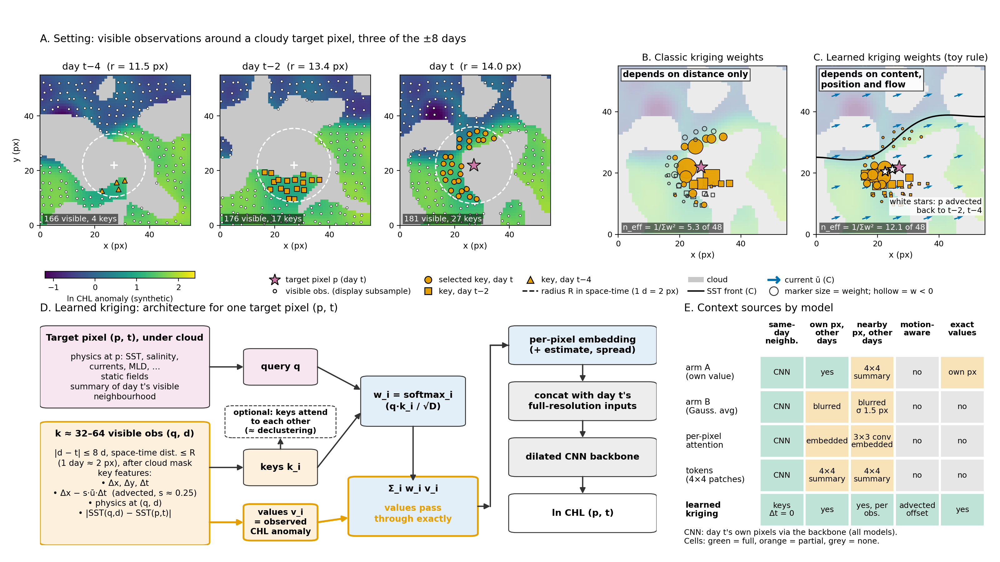

# Learned kriging: local space–time observation attention

Figure: `python analyses/kriging_explainer/explainer.py` (project root, no GPU, seed 7). Every field is synthetic. The weights in B are ordinary kriging. The weights in C come from a hand-written toy rule, not from a trained model.

## Classic kriging
A cloudy target pixel gets a weighted sum of nearby observations, z*(p) = Σ_i w_i z(q_i). The weights come from a covariance fitted on distance alone, plus perhaps a fixed anisotropy. They solve a linear system, so clustered observations share weight. That system can also make some weights negative (hollow markers in B). Kriging returns an estimate and a variance. Space–time kriging adds the time lag through a fixed space–time metric.

## Learned kriging
Attention computes the weights instead.
- **Query:** the target pixel p on day t: physics at p (SST, salinity, currents, MLD, ...), static fields, and a summary of day t's visible neighbourhood.
- **Keys:** one per nearby visible observation (q, d), taken within ±8 days and radius R after cloud masking (k ≈ 32–64 nearest; 1 day ≈ 2 px). Key features:
  - the offset (Δx, Δy, Δt);
  - the advected offset Δx − s·ū·Δt (s ≈ 0.25);
  - the physics at (q, d);
  - |SST(q,d) − SST(p,t)|.

  Day t's own visible pixels enter as keys with Δt = 0.
- **Values:** the observed CHL anomaly at (q, d), passed through exactly, never smoothed.
- **Weights:** softmax(q·k), which acts as a learned covariance that is anisotropic and depends on the ocean state. Keys can optionally attend to each other first, which plays the role of kriging's declustering.
- **Output:** a per-pixel embedding, optionally with an estimate and a spread. It joins day t's full-resolution inputs as extra channels into the existing dilated CNN backbone.
- **Cost:** pixels × k dot products.
- **Prior work:** close to the attentive neural process (Kim et al. 2019), restricted to a local space–time neighbourhood.

## How it differs from the existing stems (panel E)
- arm A blends only the pixel's own value on other days.
- arm B uses a fixed Gaussian local average (σ 1.5 px), which blurs near-pixel detail.
- The per-pixel attention stem attends over per-day 3×3-conv embeddings.
- The token models summarise 4×4-pixel patches.

Learned kriging selects individual observations across space and time, accounts for the current, and passes their values through exactly.

## Panels
- **A:** synthetic ln-CHL with a front and an eddy, advected along the front, shown on days t−4, t−2 and t. Grey areas are cloud. The space–time radius shrinks with |Δt|, and the k = 48 nearest visible observations become keys.
- **B:** ordinary-kriging weights from an isotropic exponential covariance in space–time distance.
- **C:** toy "learned" weights, which are larger for a small |ΔSST| and a small advected offset (longer along the front). The figure also shows the SST front, the current and p advected back in time.
- **D:** the architecture. **E:** the context sources each model uses.
