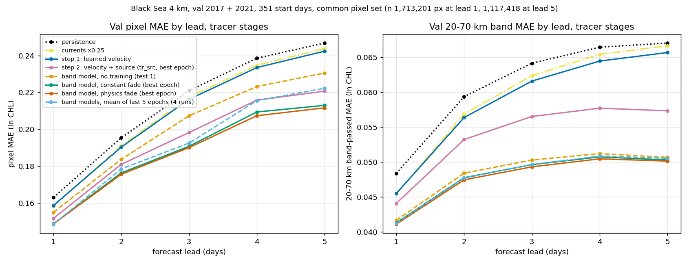

# CHL as a tracer: learning how chlorophyll moves and changes (Black Sea 4 km, 2026-10-18 to 10-20, shelved)

**Question.** Can we predict tomorrow's ln CHL from today's by treating CHL as a tracer, moved by an effective velocity
learned from the physics plus a source term, and does that help gap filling and gradients at fisheries scales (20–70 km)?

**Status.** Shelved on 2026-10-20. The best model is a mean + anomaly ("band") model:
- a smooth baseline plus three anomaly bands (< 20, 20–50 and 50–150 km);
- each band is moved by its own scaled current and fades at its own rate.

It beats every earlier tracer at every lead. Most of its gain comes from fading, not moving. Two gating checks found
little left to gain from better motion. Numbers are in [FINDINGS.md](../FINDINGS.md) (2026-10-18 to 10-20 entries) and
[results/band_test2.md](results/band_test2.md).

## Set-up

- **Data.** Black Sea 4 km store (`blk4`), cropped to 177 × 273 px; 1 px ≈ 4.5 km.
  - Copernicus reanalysis currents, SSH (for geostrophic currents) and wind stress.
  - Source inputs: SST, rsntds (light), mixed-layer depth, friver (rivers), salinity, depth and coast distance.
- **Task.** Forecast observed ln CHL on day t+k from day t, k = 1–5. This is a forecast, not gap filling: there is no
  CHL input after day t.
- **Split and scoring.**
  - Train 2,449 start days; val 351 start days (every 2nd in 2017 and 2021); test years not scored.
  - Pixel MAE in ln CHL, plus MAE on the 20–70 km band-passed field.
  - All rows in a table are scored on the same pixels. The test-1 common set has 1.71 M px at lead 1 and 1.12 M at lead 5.
- **Integrator** (`chl_cnn/tracer.py`).
  - Backward RK2 trajectories, 4 sub-steps per day, bilinear `grid_sample`.
  - Valid only if the path stays on valid currents and the departure point is observed (≥ 0.99 weight).
  - Passed synthetic checks: displacement error ≤ 6e-5 px, a known factor recovered to 0.997.

## Stages and results (val, common set)

| stage | model | MAE lead 1 | lead 3 | lead 5 | 20–70 km band, lead 1 / 5 | gradient ratio / corr, lead 1, 1 px |
|---|---|---|---|---|---|---|
| baseline | persistence | 0.1630 | 0.2209 | 0.2467 | 0.0484 / 0.0670 | 1.005 / 0.459 |
| baseline | currents × 0.25 | 0.1584 | 0.2174 | 0.2438 | 0.0455 / 0.0666 | 0.892 / 0.512 |
| step 1 | learned velocity: a·u_rea + b·u_geo + wind | 0.1586 | 0.2162 | 0.2423 | 0.0455 / 0.0657 | 0.896 / 0.511 |
| step 2 | step 1 + pointwise source S along the path (tr_src, best epoch) | 0.1516 | 0.1982 | 0.2206 | 0.0441 / 0.0573 | 0.840 / 0.516 |
| band, test 1 | baseline + 3 bands, × 0.25 currents, measured fade times, no training | 0.1549 | 0.2072 | 0.2305 | 0.0417 / 0.0507 | 0.669 / 0.547 |
| band, test 2 | learned speed and fade per band + baseline source, constant fade (best epoch, 2 seeds) | 0.1487–0.1491 | 0.1907–0.1926 | 0.2129–0.2143 | 0.0413 / 0.0502–0.0503 | 0.618–0.620 / 0.563–0.566 |
| band, test 2 | same, fade time a function of physics (best epoch, 2 seeds) | 0.1486–0.1489 | 0.1900–0.1916 | 0.2116–0.2131 | 0.0411–0.0412 / 0.0500–0.0502 | 0.604–0.610 / 0.568 |
| band, test 2 | all 4 runs, mean of the last 5 epochs | 0.1485 | 0.1925 | 0.2222 | 0.0413 / 0.0505 | 0.604–0.617 / 0.566–0.570 |

**Differences.** Day-bootstrap 95% CIs, from [results/band_test2.md](results/band_test2.md).

| comparison | lead 1 | lead 3 | lead 5 |
|---|---|---|---|
| band (best epoch) minus step 1 | −0.010 | −0.024 to −0.026 | −0.028 to −0.031 |
| band (best epoch) minus step 2 | −0.002 to −0.003 | −0.006 to −0.008 | −0.006 to −0.008 |
| band (last 5 epochs) minus step 2 | −0.003 | −0.006 | 0.000 to −0.002 (CI includes 0) |
| physics fade minus constant fade, matched seed | ≤ 0.0004 | −0.0016 to +0.0009 | −0.0018 to +0.0016 |

- All CIs exclude 0 against step 1.
- Every band model is the best tracer in every region scored at lead 1. The largest margin is in W open sea:
  0.128 vs 0.130 for step 2 and 0.138 for step 1. Azov has no currents, so it is not scored.
- Seeds agree. Step-1 seeds differ by 0.0001–0.0003 per lead; band-model seeds by ≤ 0.002.

## What the models learned

**Velocity factor (fraction of the reanalysis current).**

| model | factor |
|---|---|
| step 1 | 0.16–0.17 (ocean mean; stops moving after epoch 1) |
| step 1b: geostrophic / ageostrophic × mean / anomaly, per region × season | 0.54–0.60 for the mean geostrophic current in the open sea; 0.08–0.20 for the other parts |
| step 2 | 0.19–0.22 (rises with the source) |
| band model, < 20 / 20–50 / 50–150 km | 0.67–0.73 / **0.02–0.03** / 0.34–0.37 |

**Fade times (days).**

| band | measured coherence e-folding | learned, constant | learned, physics (base τ) |
|---|---|---|---|
| < 20 km | 1.67 | 0.97–1.14 | 1.35–1.39 |
| 20–50 km | 2.38 | 2.30–2.60 | 2.25–2.29 |
| 50–150 km | 13.77 | 9.3–10.9 | 12.7–13.3 |

- **Physics-dependent fade.** Both seeds show the same shape
  ([figures/band_test2_tau_pd.png](figures/band_test2_tau_pd.png)). Fade time gets shorter with:
  - higher strain;
  - faster currents;
  - a deeper mixed layer;
  - winter (DJF).

  The mean multiplier on the base fade time is about 1.7–2.3 in spring and summer and 0.7–1.7 in winter and autumn.
- **Baseline source.** −0.01 to −0.05 ln CHL/day, basin mean, most negative in spring and summer. Across epochs, lead-5
  MAE is worse when the source is less negative (r −0.58 to −0.68 over 20 epochs).

## Diagnostics: why the learned velocity factor is low

| check | result |
|---|---|
| MAE against velocity factor, scanned (u_eff = a·u_rea) | minimum at 0.31 at lead 1, falling to 0.15 at lead 5; 0.41 on moving patches, 0.18 on patches that don't move |
| sub-steps (1 / 4 / 16), sampling kernel, current timing ±1 day | the minimum moves by ≤ 0.07 |
| learning rate | converges to 0.17 from any start if lr ≥ 3e-2; small lr just hasn't moved |
| trained 0.17 vs train-loss minimum 0.21 | autograd ignores pixels entering or leaving the valid set as the factor changes. Finite differences with the mask held fixed match autograd within 3%. |
| synthetic fields with a known factor of 0.5 | recovered (0.48–0.50) unless a stationary component and fading are added. Then it drops to 0.10, matching the real data. |
| tracked feature motion (masked NCC, 77 k patches) | 0.46 / 0.42 × reanalysis (east / north). Direction agreement is weak: R 0.51, R² 0.24–0.38. |
| coherence at a fixed point vs lead | e-folding 1.6 d (15–20 km), 4.8 d (48 km), 10 d (72 km), 22 d (144 km) |

## Gating checks for flow estimated from the images (2026-10-20, [../flow_gate/results/flow_gate.md](../flow_gate/results/flow_gate.md))

| check | result |
|---|---|
| **A: oracle shift at lead 1.** Day t shifted by the measured patch shift, on 12,044 tracked patches (41% of val pixels) | Ties currents × 0.25 on whole patches (0.1381 vs 0.1380). On the 16 × 16 px core it gains 0.008 (0.1324 vs 0.1404). |
| **B: motion-only fill of the gap-filler's hidden pixels.** Nearest visible day in t−4..t+4, moved with × 0.25 currents | Worse than the best gap-filler everywhere: by 0.147 at 1 px into the gap, by 0.045 at 16+ px. Gradient ratio 1.06–1.17 vs 0.54, correlation 0.30–0.34 vs 0.64. |

Coverage is 61% of hidden pixels. Azov and Marmara have no currents.

## Interpretation

- **Fading, not moving, carries the gain.** Turning motion off in test 1 costs only 0.001–0.002. The 20–50 km band
  learns to stay almost still in both seeds. This fits a mixture of stationary structure (coast, bathymetry, river
  plumes) and short-lived moving structure, though the mechanism isn't shown.
- **Better motion has little headroom at these scales.** The oracle ceiling is ≤ 0.008 on the pixels where motion can
  be measured at all.
- **The band model's low gradient ratio (0.60–0.62) comes from fading, which is a form of shrinkage.** It has the best
  gradient correlation of any tracer (0.57). The MAE optimum trades gradient magnitude for correlation here, as in the
  gap-filler.
- **Physics-dependent fade is within ±0.002 of constant fade.** Its partial dependences repeat across seeds, so the fade
  rate does depend on strain, mixed-layer depth and season. It just doesn't change MAE much.

## Open questions

- Persistence from day t−1 scores 0.19 on the gap-filler's hidden pixels, against 0.16 on the tracer's observed pixels.
  Why the gap is that large is unchecked.
- Lead-5 val MAE swings 0.010–0.021 between epochs in every learned-source run. The swings follow the training batch
  order (diagnostics) and shrink with smaller steps or a tighter source bound. Not fixed.
- Would the band decomposition help as gap-filler context? Warped, band-wise context channels in the 3D stem are
  untested, and check B only shows that motion alone is not enough.

## Untried speed-ups

An epoch takes about 200 s (≈ 70 min for 20 epochs); the model has a few thousand parameters. Cost is the integrator:
5 leads × 3 bands × (1+…+5) days × 4 sub-steps = 180 RK2 sub-steps per start day, each step checkpointed (computed
twice). If the work resumes:
- 1 sub-step instead of 4 (the minimum doesn't move);
- chain one-day displacement maps across leads; CHL is still sampled only once;
- cache the fixed reference predictors instead of recomputing them every epoch;
- run 3–5 epochs (best epochs were 2, 2, 5 and 8).

## Code and models

| path | contents |
|---|---|
| `chl_cnn/tracer.py` | Integrator, VelocityModel, DecompVelocity, SourceModel, BandPass |
| `chl_cnn/train_tracer.py` | steps 1, 1b, 2 (`--terms`, `--vel-param decomp`, `--loss-band`, `--source`) |
| `chl_cnn/tracer_band.py`, `analyses/tracer/band_train.py` | band model (test 2); `band_test1.py` (test 1), `band_report.py` |
| `chl_cnn/tracer_static.py`, `chl_cnn/tracer_diag.py`, `analyses/tracer/static_*.py`, `diag_*.py` | baseline and diagnostic studies |
| `chl_cnn/tracer_viz.py`, `notebooks/progress.ipynb` (tracer section) | training curves and factor / source maps |
| `analyses/tracer/summary_fig.py` | the figure above |
| `analyses/flow_gate/` | gating checks A and B |

Checkpoints were deleted on 2026-10-20 except three runs (config, history, metrics and prediction files remain for all runs):
- `models/tracer/trb_phys_s0`: best band model, physics fade; `ep{n}.pt` for every epoch, best is epoch 5.
- `models/tracer/trb_const_s0`: best band model, constant fade; best is epoch 8.
- `models/tracer/tr_rea_geo_wind/model.pt`: step 1. `band_train.py`, `band_test1.py` and the `static_*` scripts load it
  as the step-1 reference.

Band runs load `~/mind_the_chl_gap/data/static_bases` (the 150 km low-pass baseline) and
`~/mind_the_chl_gap/data/band_common` (the common pixel mask).
